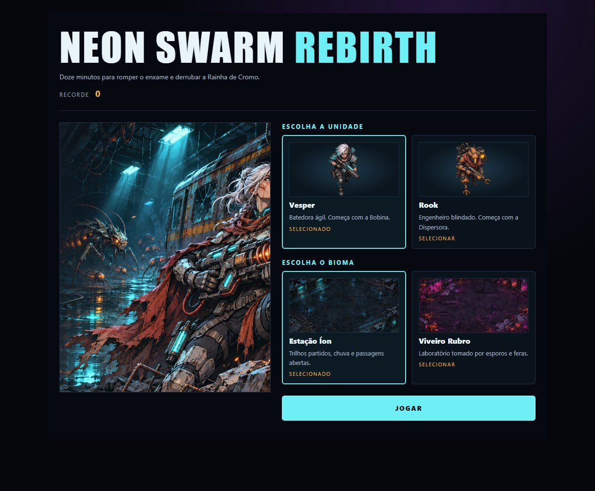

# NEON SWARM: REBIRTH

Arena survivor sci-fi para navegador. Escolha Vesper ou Rook, atravesse a Estação Íon ou o Viveiro Rubro e sobreviva por 12 minutos para derrotar a Rainha de Cromo.

**[Jogar Rebirth](https://ald3b4r4n.github.io/NeonSwarm/rebirth/)** · [Versão original](https://ald3b4r4n.github.io/NeonSwarm/)

- **Teclado** — WASD ou setas para mover, Espaço para pulso, Esc ou P para pausar e 1–3 para escolher upgrades.
- **Toque** — arraste na arena para mover e use os botões para pulso, pausa e upgrades.
- **Combate** — ataques automáticos, seis armas com cinco ranks, oito linhas de upgrades de atributos e duas sinergias.
- **Partida** — seis famílias biomecânicas, obstáculos por bioma, elites e uma chefe com rajadas, espirais e invocação de reforços.

[Início](docs/screenshots/inicio.jpg) · [Horda](docs/screenshots/horda.jpg) · [Rainha](docs/screenshots/rainha.jpg) · [Resultado](docs/screenshots/resultado.jpg) · [Clipe](docs/screenshots/partida.webm)

Requer Node.js 24. Execute `npm ci` e `npm run dev`. Rode `npm run build`, `npm run typecheck`, `npm run lint` e `npm test` para validar. Instale Chromium via `npx playwright install chromium` e execute `npm run test:e2e` contra o build.

[Arquitetura proposta pelo Claude](docs/rebirth-arquitetura.md) · [Direção de arte do Spark](docs/rebirth-arte.md) · [Implementação, assets, créditos e testes](docs/rebirth.md)
