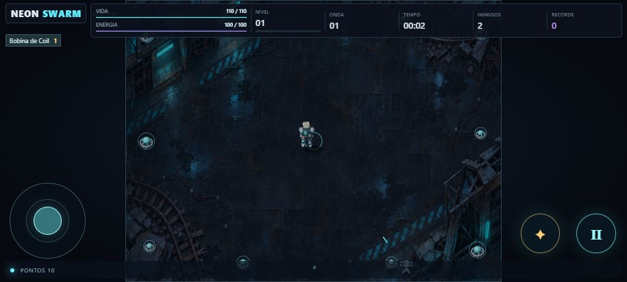
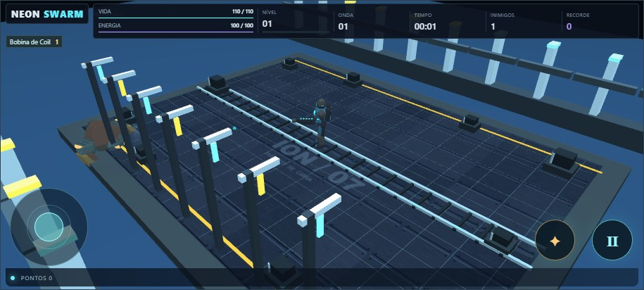

# REFORGED — diagnóstico da Preview 2

O aceite físico no POCO X8 Pro reprovou a apresentação da Preview 2. Os testes da versão validavam regras do jogo e controles; não mediam qualidade visual.

| Camada | Causa observada na baseline 0094e8422d67 | Contrato para a reconstrução |
| --- | --- | --- |
| Modelos | As fontes Blender combinam primitivas com pivôs. Não preservam malha, materiais e rig no navegador. | GLB com malha e skin importado em runtime. Fontes editáveis, PBR e clipes nomeados. |
| Animação | Quatro quadros renderizados por ação. A folha limita a pose, os ângulos e as transições a imagens predefinidas. | Ações esqueléticas interpoladas, reação à direção, recoil e dano. |
| Render | Workbench gera imagens 128 × 128 que são recortadas em células WebP de 96 × 96. O Canvas desenha a arte achatada. | Babylon WebGL, câmera ortográfica oblíqua, luz, superfícies e profundidade na cena. |
| Cenários | Imagem 2D com props animados em cima. Campo Canvas limitado a 4:3. | Piso e estruturas no mundo 3D; proporção adaptada à viewport e o jogador no enquadramento. |
| Combate | Ranks mudam números e traços, mas a arma não se move com o disparo. | Arma ligada ao rig; trajetória, preparação, impacto e leitura da evolução visíveis na partida. |

A vertical slice é a primeira etapa. Deve mostrar Vesper, drone, Estação Íon e Bobina em combate. O motor determinístico em src/game continua sendo a fonte das regras; a cena lê seu estado, sem decidir dano, acertos ou recordes. A câmera e os efeitos não alteram as coordenadas da simulação. A expansão depende do parecer visual e do aceite físico; o rótulo de produto completo não se aplica à demonstração.

## Reprodução dos modelos

Blender 4.5.4, a partir da raiz:

```powershell
blender -b --factory-startup --python-exit-code 1 --python scripts/build-reforged.py -- --root . --capture docs/reforged
node scripts/inspect-reforged-assets.mjs
```

A malha usa anéis perfilados, chanfrados e agrupados por material, com peso rígido por peça para a armadura. A textura de abrasão é produzida pelo script e incorporada ao arquivo. Não há imagens de terceiros. Os materiais usam metalness, roughness e emissão. Os arquivos GLB têm pé na origem, eixo Y para cima, frente +Z e nenhuma dependência externa. As capturas do Blender são renders Cycles de referência, separadas das capturas do jogo.

## Demonstração jogável

A [vertical slice REFORGED](https://ald3b4r4n.github.io/NeonSwarm/reforged/) apresenta Vesper, drone, Estação Íon e Bobina de Coil. Use **Jogar** para entrar. No desktop, mova com WASD ou setas. No celular, use o joystick em landscape.

| Preview 2 · Canvas 2D · 915 × 412 | REFORGED · Babylon WebGL · 915 × 412 |
| --- | --- |
|  |  |

- [Vídeo de gameplay e da Bobina do rank 1 ao 5](babylon-bobina.webm). O vídeo grava o canvas WebGL. A captura verificou a queda de HP e os clipes `idle`, `run`, `turn`, `fire`, `recoil` e `hurt`.
- Capturas por rank da Bobina [1](bobina-1.jpg), [2](bobina-2.jpg), [3](bobina-3.jpg), [4](bobina-4.jpg) e [5](bobina-5.jpg).
- [Cena de stress](babylon-stress-50.jpg). O painel indicou 66 inimigos no início da captura publicada. Duas amostras de três segundos no Chrome desktop em viewport móvel, durante a execução de testes em paralelo, registraram 36,6–57,6 FPS e p95 de 16,8–50 ms. Na captura publicada, a cena reportou 62 atores de inimigo, 476 draw calls e 280.304 triângulos ativos. O contador de draw calls e o tempo CPU de renderização são medidas do Babylon. O POCO X8 Pro ainda precisa de medição física.
- [Vesper no Blender](vesper-blender.png), [drone no Blender](drone-blender.png) e [manifesto de modelos e clipes](manifest.json). Fontes [Vesper](../../art/reforged/vesper.blend) e [drone](../../art/reforged/drone.blend). Exportações [Vesper](../../public/reforged/vesper.glb) e [drone](../../public/reforged/drone.glb).

Para repetir as capturas no Chrome desktop, rode `npm run build` e `node scripts/capture-reforged.mjs`. A captura verifica o carregamento dos dois GLBs, erros de compilação de shaders, dano em Vesper e a contagem inicial da horda. O cenário ficava invisível no Chrome de teste porque o shader excedia o limite de blocos de uniformes de vértice. A demo usa uniformes convencionais no Babylon para que o cenário e a iluminação sejam renderizados nesse driver.

## Execução e escopo

- A integração reaproveitou o trabalho de renderização da Luna Max. O job Hivemind `9a410810a8b0cd5f2e5a680e3d409e4d` registrou timeout de `p002-babylon`. A recuperação e integração da worktree estão no commit `1757059`.
- `claude auth status` retornou `loggedIn: false`. Sonnet e Haiku ficaram bloqueados no preflight. O Codex integrou a implementação recuperada e verificou a demonstração.
- A campanha e o arsenal continuam usando a simulação existente. O renderer apresenta os demais inimigos com variações do drone e o cenário da Estação Íon. A segunda personagem, o pesado, a Rainha e o Viveiro Rubro precisam de arte 3D própria. A Bobina recebeu o trabalho de combate e efeitos desta etapa. A expansão visual, a paridade da Preview 3 e o aceite físico continuam pendentes.

- O [parecer independente do Muse Wonder High](parecer-wonder.md) confirma a mudança visual e mantém o gate de produção em escala pendente. A análise compara imagens em 915 × 412 e os renders dos modelos.
